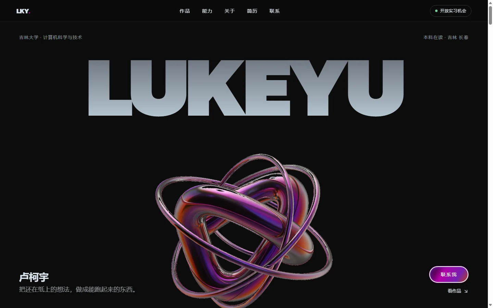
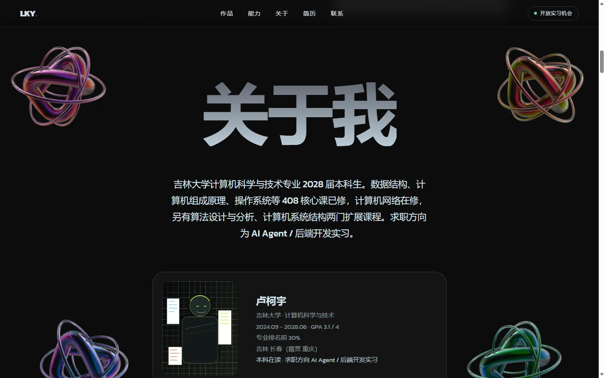
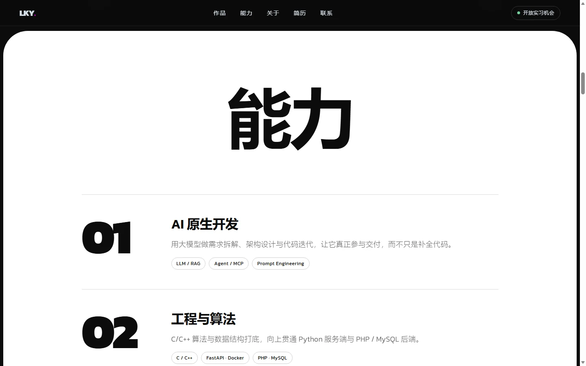
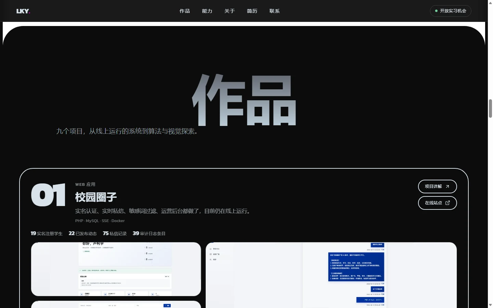
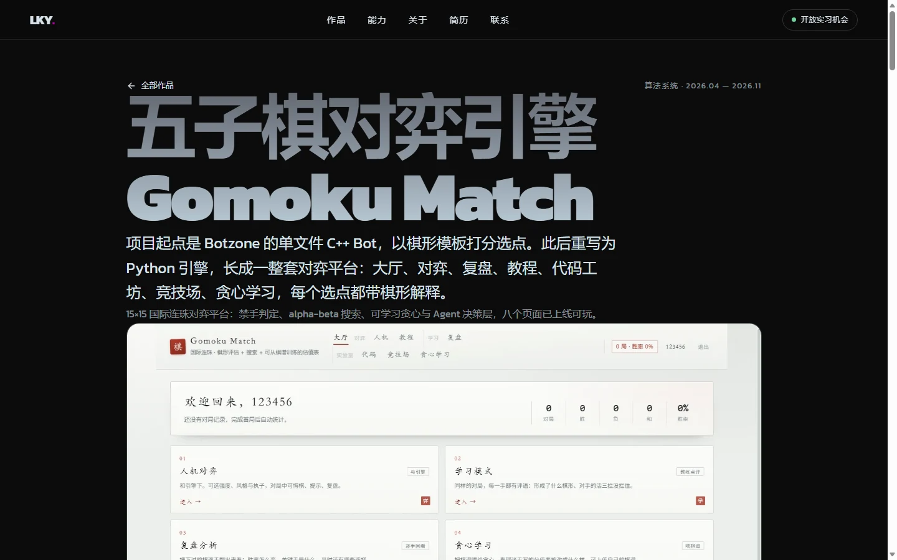
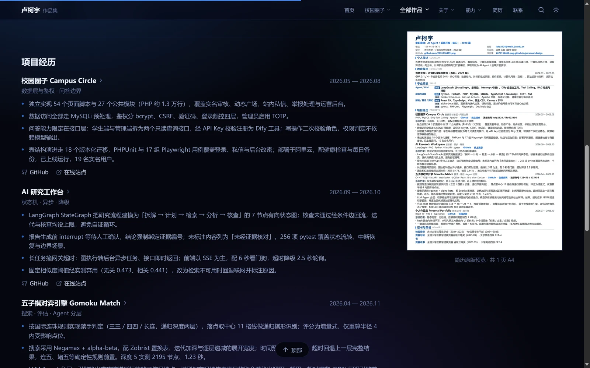
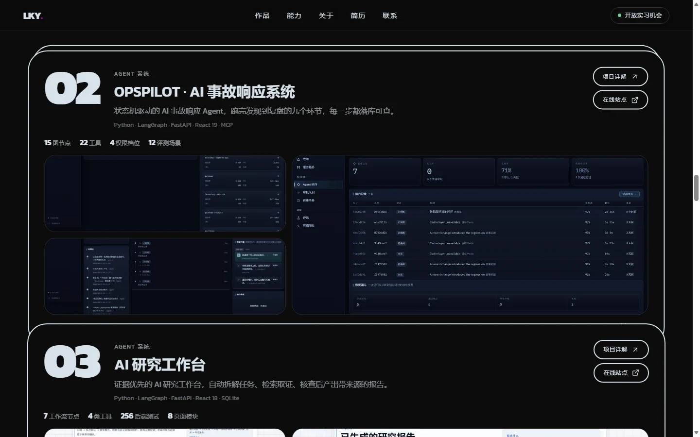
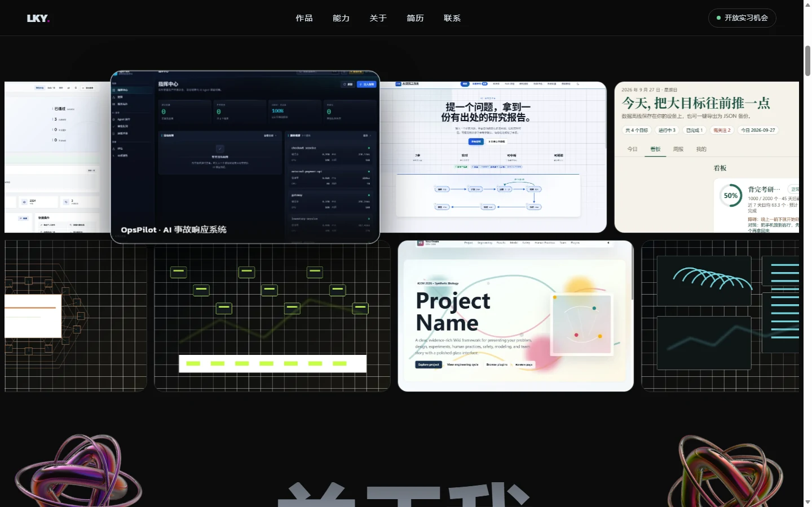

# 个人作品集

卢柯宇的作品集网站。React 19 + Vite 6 单页应用，hash 路由。当前外观是 3D 视觉重构版：纯黑底、Kanit 渐变大标题、两行自行反向滚动的作品带、白底反差的能力区、逐层缩放的 sticky 作品卡。

<p align="center">
  
  
</p>

首屏只讲项目，学校与成绩放在关于页和简历页。九个作品全部从同一份 `src/data.js` 派生，校园圈子映射成统一形状后与另外八个项目一起渲染。

<p align="center">
  
  
</p>

## 工程回退

站点只有一套对外外观，导航与页脚都不再提供旧版入口。`?skin=legacy` 是不对访客露出的隐藏开关：136 条 SSR 冒烟和两套历史布局脚本仍钉在旧版 DOM 上，留着才能继续跑回归，出问题时也能立刻切回来。

旧版 CSS 只在隐藏分支动态加载。`styles.css` 里有 `body`、`h1`、`a` 这类全局选择器，静态 import 会把新版一起染色；新版 `site.css` 的选择器全部挂在 `.v3` 下，反过来不影响旧版。SSR 冒烟脚本渲染的是旧版 `AppShell`。

## 在线地址

- 主站：https://2676136489-png.github.io/personal-design/
- 镜像：https://2676136489-png.github.io/personal-design/

两个站部署方式不同，源码相同、构建参数不同，改完各自发布。

## 页面

| 路由 | 内容 | 动效 |
| --- | --- | --- |
| `/` | 首屏、数据条、作品滚动带、关于、能力、堆叠卡、时间线、简历、联系 | 反向自动滚动带、悬停单行冻结并放大、逐字显影、磁吸主视觉、sticky 缩放 |
| `/works` | 九个项目的卡片网格，可按方向筛选 | 进场淡入 |
| `/resume` | 完整网页简历，与 PDF 同源 | 进场淡入 |
| `/category/:slug` | 方向聚合页 | 进场淡入 |
| `/:slug` | 项目详情，章节按 `data.js` 的六种块统一渲染 | 章节时序入场 |
| `/about` `/skills` `/contact` | 首页对应板块的锚点 | 滚动定位 |

<p align="center">
  
</p>

## 收录的作品

| 项目 | 方向 | 时间 |
| --- | --- | --- |
| [OpsPilot · AI 事故响应系统](https://2676136489-png.github.io/personal-design/demo/opspilot.html) | Agent 系统 | 2026.09 — 2026.10 |
| [AI 研究工作台](https://2676136489-png.github.io/personal-design/demo/research.html) | Agent 系统 | 2026.09 — 2026.10 |
| [校园圈子](https://www.lucky-campus.top) | Web 应用 | 2026.05 — 2026.08 |
| [五子棋对弈引擎 Gomoku Match](https://2676136489-png.github.io/personal-design/demo/gomoku.html) | 算法系统 | 2026.04 — 2026.11 |
| iGEM Glass Wiki 插件 | Web 组件 | 2026.07 |
| 个人作品集 | 前端开发 | 2026.07 — 2026.10 |
| 学习目标管理台 | Web 应用 | 2026.09 |
| 菜鸟驿站快递管理系统 | 系统设计 | 2024.09 — 2024.12 |
| 校园服务视觉系统 | 品牌视觉 | 探索性设计 |

每个项目都有独立详情页，正文按章节讲设计取舍。页首是封面与三格界面图集，再往下才是章节，正文里引用过的截图不会在图集里重放一遍。

<p align="center">
  
</p>

简历页与 PDF 是同一份材料的两份形态：首页给一段预览与荣誉，`/resume` 能读到完整的项目要点和排好版的原版。

<p align="center">
  
</p>

## 结构

```
index.html
src/
  main.jsx          入口，默认只挂新版；旧版只走隐藏分支的动态 CSS
  v3/
    App.jsx         hash 路由、锚点滚动
    content.js      从 data.js 派生九个作品、导航、滚动带数据
    lib.jsx         FadeIn / Magnet / AnimatedText / 按钮
    sections.jsx    首页八个板块
    Detail.jsx      作品详情、全部作品、方向聚合、完整简历
    site.css        新版样式，全部作用域在 .v3 下
  app/App.jsx       旧版路由表、主题、全局转场
  app/Nav.jsx       旧版全局导航与移动端抽屉
  app/Footer.jsx    旧版站点地图与页脚
  pages/            旧版六个页面 + 404 + 三个迁移页
  motion/scroll.tsx GSAP 注册、作用域、揭示动效基座
  lightbox.jsx      图片灯箱
  motion.jsx        迁移页仍在用的逐字揭示与视差
  router.js         hash 跳转与锚点滚动的两个小工具
  data.js           全部内容数据
  design-system.css 旧版设计系统（变量、栅格、按钮、卡片）
  styles.css        旧版配色变量与基础样式
  tw.css            Tailwind 变量桥接
public/media/       图片素材（全部 WebP）
media-src/          截图源图（PNG），不进产物
docs/images/        README 配图
scripts/            构建部署、图片处理、验证脚本
```

## 技术选择

以下多数条目记录的是隐藏分支里那套旧代码的实现取舍，它仍完整保留在仓库里供回归测试使用。重构版换用了 Framer Motion 做进场与滚动驱动，Kanit 字体自托管在 `@fontsource/kanit`，运行时不依赖 Google Fonts。

**hash 路由**。站点同时部署在根目录和 `/personal-design/` 子路径下，hash 路由不依赖服务端 rewrite，刷新任意深层页面都不会 404。

**`--base` 只在构建时传参**。主站在根目录、镜像站在子路径，前缀不同，所以不能写死在 `vite.config.js` 里。镜像站的构建由 `scripts/deploy-pages.mjs` 带上 `--base=/personal-design/`。

**`public/` 下的图片路径要用 `asset()` 包一层**（`src/data.js` 导出）。Vite 只改写 HTML 和 `import` 的路径，不碰 JS 字符串字面量，所以得自己拼 `import.meta.env.BASE_URL`。写死绝对路径在主站看着正常，到子路径下就整片 404。

**动画一律走 ScrollTrigger，不做常驻循环**。随滚动变化的量交给 `scrub`，进场的量交给「触发一次」的时间线。没有粒子、没有呼吸光、没有自己转的装饰。

**`pin` 之前，祖先链上不能有 `transform`**。这是这个项目最容易踩、也最难查的一处。`position: fixed` 的包含块是最近的、带 `transform` 的祖先。ScrollTrigger 的 `pin` 就是靠给元素加 `position: fixed` 实现的，祖先上只要有一个 `transform`（哪怕动画结束、值等于恒等变换，或者只是 `will-change: transform`），pin 就会被钉在那个祖先里。现象是整块画廊被顶出视口，量出来的 `bandTop` 恒等于 `-scrollY`。

这件事踩了两次。第一次是路由转场容器写了 `will-change: transform, opacity`；第二次是旧样式表里 `main { animation: page-in ... both }`，`fill-mode: both` 在动画结束后仍然保留恒等 `transform`。解法是转场动画结束时显式 `clearProps: 'transform'`，并且给这条规则加了断言。

**吸附自己算，不用 ScrollTrigger 内置的 `snap`**。内置 `snap: { snapTo }` 在单次大跳跃滚动时传进来的 `progress` 与实际几何不一致：实测滚到 1400px，它按 0.37 算，落点是第四屏而不是第二屏。渐进滚动反而正常，所以这个问题在手动测试时很难发现。

改成从 `onUpdate(self)` 取 `self.progress`（权威值），停 180ms 后按 `st.start + target * (st.end - st.start)` 滚过去。拖拽期间不吸附，松手时用当前 `scrollY` 反算一次再吸附。

**拖拽时逐帧 `scrollTo` 必须用 `behavior: 'instant'`**。站点全局开了 `scroll-behavior: smooth`，不带 `instant` 的话每一帧都会被平滑一次，手指移开半秒画面还在追。

**移动端不是把桌面版缩小，是换一套版式**。`<768px` 时画廊关掉 `pin` 与拖拽，降级为纵向 Bento 网格，只留淡入；叙事页关掉遮罩，封面改成一次淡入；首屏不再撑满一屏高度。这些分支写在 `matchMedia` 里，不是靠 CSS 硬扛。

**遮罩的初始 `clip-path` 只写在桌面断点里**。`clip-path: inset(0 0 100% 0)` 是「完全收起」，桌面版靠 GSAP 随滚动把它揭开。手机上不跑那段动画，初始值留着就会把封面整块裁没，首屏一片空白。

**两列的列定义必须写在 CSS 里，不能写在 inline style**。inline 的优先级高于媒体查询，写 `style={{ gridTemplateColumns: '1fr 1fr' }}` 之后，任何 `<860px` 的折叠规则都盖不过它。联系页就是这么坏的：窄屏两列挤在一起，长邮箱顶出自己的格子压在表单上。现在统一用 `.ds-split`，页面上只传 `--split` 比例变量。

**排版重置用 `:where()` 把特异性降到 0**。`.ds-page p { margin: 0 }` 的特异性是 0,1,1，会盖掉 `.ds-eyebrow { margin-bottom: 24px }`（0,1,0）。眉标下面那 24px 从来没生效过，标题一直贴着它。

**移动端卡片的标题放在图下面，不压在图上**。压图版本用一层渐变加白字，但封面截图本身明暗不定，渐变薄了白字就糊在浅色界面上，实测对照度 1.4:1。改成正常流的图 + 文字块，任何封面都成立。

**从旧站迁过来的三个页面只换皮，不重写结构**。作品详情、方向聚合、简历页是长文档，结构本身没问题，问题是旧皮肤：渐变标题字、980px 药丸按钮、彩色描边小标签、20px 圆角配重阴影。这些统一收在一层 `.legacy-doc` 覆盖里，缩到新系统的一套圆角、一套按钮、一套眉标。

**`` 上的 `width` / `height` 是固定像素尺寸提示**，优先级低于 CSS、高于 `auto`。只写 `width: 100%` 而不写高度时，高度会被属性里那个定值顶住，图片纵向变形。所以全局 `img` 规则里显式写了 `height: auto`。

主题偏好存在 `localStorage`，key 带版本号（`portfolio-theme-v2`）。整体视觉换过一次之后，旧 key 里存的偏好属于上一套外观，继续沿用会让访客看不到新样式。

### 重构版的几个取舍

**作品卡的三格素材全部互不重复**。有线上界面的项目用各仓库 README 里挑过的真实截图，或从线上站点抓的不同视图。菜鸟驿站、iGEM Wiki 插件与视觉探索没有线上界面，就放一张真实封面，另外两格用章节名和实测数据做信息面板。之前用同一张封面补齐三格，九张卡里有六张是复制粘贴。断言逐卡检查图源唯一。

<p align="center">
  
</p>

**主视觉用抽象雕塑，不用人物肖像**。首屏那件紫橙渐变的环形 3D 物体是生成的。白底按「离纯白的距离」算 alpha 抠掉，环内部的镂空本来就该透出黑底。`scripts/make-hero-3d.py` 输出 90KB 的透明 WebP。关于页四个角的装饰是同一张图做旋转与色相偏移。

**渐变标题的动画 transform 放在外层 wrapper**。`background-clip: text` 与元素自身的 transform 在部分浏览器里会互相干扰，直接把淡入写在 `h2` 上会让文字消失。

**逐字显影的区间压在 progress 0—0.9**。铺满 0—1 时最后一个字永远差一点点，停在 0.2 的灰上；留出尾部余量，读者滚到段落时文字已经全亮。

**新版 `` 也要写 `height: auto`**。旧版那条断言同样适用于重构版：带上 `width` / `height` 属性防 CLS，但不写 `height: auto` 的话属性里的固定像素会把图纵向拉长。

**按钮的文字色要压过 `.v3 a { color: inherit }`**。那条重置的特异性是 0,1,1，比 `.v3-btn-ink` 的 0,1,0 高。白底简历区里继承到的是黑字，黑底按钮就成了黑底黑字、整块看不见。按钮规则写成 `.v3 a.v3-btn-ink` 并显式指定 `-webkit-text-fill-color`。断言逐个量所有实心按钮的前景色与底色，判据本身配了正反例自测。

**滚动带的循环周期按「一组图 + 组间距」实测**。三倍复制的图片里，相位走满一个周期时第二组正好顶到第一组原来的位置，取模跳回 0 看不出来。周期用 tile 实测宽度加 CSS `columnGap` 算，拿 `scrollWidth / 3` 近似会少一个间隔，接缝处每圈抖 12px。

**两行的暂停状态各自独立**。鼠标进入哪一行就把哪行的速度缓降到 0，另一行照跑；停稳后连页面滚动的视差也不再写进 transform，否则「停下的行」还会跟着页面飘。移开鼠标再缓升回原速。页面滚动的视差只在 scroll 事件里算好缓存，rAF 里不读 `getBoundingClientRect`。

<p align="center">
  
</p>

## 本地开发

```bash
npm install
npm run dev
```

## 构建与发布

```bash
npm run build          # 产物在 dist/
```

主站以静态服务方式托管 `dist/`，监听 `$PORT`：

```bash
cd dist && python3 -m http.server ${PORT:-3000} --bind 0.0.0.0
```

镜像站：

```bash
node scripts/deploy-pages.mjs
```

脚本重新构建到 `dist-pages/`（带 `--base=/personal-design/`），再强推到 `gh-pages` 分支。主分支只放源码，产物单独走 `gh-pages`，避免几十张截图把仓库撑大。

Pages 首次启用需在仓库 Settings → Pages 里把 Source 设为 `Deploy from a branch`，分支选 `gh-pages`、目录选 `/(root)`。

**推到 GitHub 前先确认解析地址还通**。`http.curloptResolve` 把 `github.com` 固定到一个 IP 上，直连时绕开本地 DNS，避免解析到走不通的地址。但写死的 IP 会被 GitHub 换掉。固定的那个失效后，现象是**直连 21 秒超时、代理 502，两个方向同时不通**，很容易误判成网络故障。

所以不写死地址，改为挨个探测。`scripts/github-push.js` 维护一个候选池，用 `git ls-remote` 挨个试，探到能用的就写进配置。推送失败还会换地址、换代理/直连继续重试。

```bash
node scripts/push-main.mjs      # 跑完测试再推 main，失败自动换地址重试
```

探测要用 **git 自己**探，不能用 curl。curl 走 OpenSSL，git 走 schannel（Windows TLS）。两者对边缘节点的兼容性不一样。实测出现过同一批地址里 curl 返回 200 而 git 连不上的情况。

还有两处容易踩的坑。**同一个地址会间歇性抖动**，同一条命令隔几秒可能一次通一次不通，所以探针要连试两次再判死。**代理端口还在 LISTENING 不代表上游通**（表现是 `CONNECT tunnel failed` / 502），探针前要先清掉代理环境变量。

另外 `api.github.com` 与 `raw.githubusercontent.com` 走的是另一套解析，它们通不代表 git 那条路通，判断依据要分开看。

## 图片处理

截图源图放 `media-src/`（PNG），由 `scripts/optimize-images.py` 统一转成 WebP 写到 `public/media/`，产物里不留 PNG。整站图片从 14.6MB 压到 1.9MB。

README 配图分两条链路。旧版走 `scripts/shoot-docs.mjs` 抓界面 + `scripts/make-docs-images.py` 压成 WebP。重构版走 `scripts/verify-v3.mjs` 在本地预览站上抓 `screenshots/v3-*.png`，再由 `scripts/make-v3-docs-images.py` 压到 1600 宽（`docs/images/v3-*.webp`，7 张合计 413KB）。改过界面就重跑这两步。

作品卡的截图另有一条链路。源图是各项目仓库 `docs/` 下已经挑好的界面截图，以及 `scripts/capture-portfolio-views.mjs` 从线上作品集站抓的三个画面，统一放在 `media-src/captured/`。`scripts/make-gallery-images.py` 压到 1400 宽写入 `public/media/gallery/`（15 张合计 753KB），同时生成 `src/v3/gallery-sizes.json` 供 `` 写宽高。

## 简历

简历页与 PDF 是同一份材料的两份形态，改一处要改另一处。

PDF 是最终版，放在 `public/media/resume/lukeyu-resume.pdf`。页面上那张预览图由 `scripts/make-resume-preview.py` 从 PDF 直接渲染（`resume.webp` 1588 宽、`resume-900.webp` 900 宽），保证「预览所见 = 下载所得」。从 HTML 截图会与 PDF 有出入，HTML 里那版内容比 A4 一页长。

网页上的内容全部来自 `src/data.js` 的 `resume` 字段，分三份。个人优势与项目分点技术描述在 `advantages` / `projectHighlights`。每个项目的标注行在 `projectMeta`，写的是参与方式如「Vibe Coding」。技能分组与证书在 `skillGroups` / `honors`。它们与 PDF 逐条一致，不用项目详情页的 `lede`。那是详情页的引子，讲的是「为什么做这个」，语气是散文，跟简历要的「做了什么、怎么做的」不是一回事。

项目列表由 `resume.projectSlugs` 决定，不要在页面上写死关键词。断言也从这个字段派生，改简历时只改数据不改断言。

**简历字段的存在性要单独钉一条断言**。内容断言几乎都写成 `data.resume.advantages || []` 这种带兜底的写法。好处是某个字段暂时为空也不误报，代价是字段整个被删掉时它只会说「内容为空」而不是「字段没了」。而页面里是 `resume.advantages.map(...)`。字段没了当场抛异常，简历页直接白屏。

所以 `smoke-render.mjs` 里另有一组字段契约断言，放在**渲染之前**跑：先确认 `resume` 上被页面用到的每个字段都存在，再去渲染。顺序很关键。契约断言放在渲染之后的话，字段缺失时脚本已经跳进 catch 了，后面的断言一条都跑不到。

**README 引用的配图也要断言存在**。这类坏图在本地和线上都看不出来：页面照跑，测试照过，只有真的打开 README 才发现图裂了。

**网页与 PDF 的一致性要直接读 PDF 比，不能只查数据源内部自洽。**只查「`data.js` 里有这些字」是不够的，那种断言在两边说法不一致时照样通过，因为它们查的是同一个文件。招聘方对照网站与 PDF 才发现对不上，那时已经晚了。

所以断言会读 `public/media/resume/lukeyu-resume.pdf`，把文字抽出来跟 `resume.advantages` / `resume.projectHighlights` 逐条比对。PDF 抽出来的文字跨行会被拆开，比对前先把两边所有空白去掉。改一边漏一边，这条断言立刻报出具体是哪个项目的那一条。

## 验证

三个 SSR 冒烟脚本。在 Node 侧用 `react-dom/server` 把组件真渲染成 HTML 再断言，不依赖浏览器。

```bash
node scripts/smoke-render.mjs      # 路由、内容、数据契约、设计系统约束（136 条）
node scripts/smoke-nav.mjs         # 导航结构、激活态、抽屉与主题契约（28 条）
node scripts/smoke-lightbox.mjs    # 图片灯箱结构与交互契约（43 条）
node scripts/verify-v3.mjs         # 重构版真实浏览器冒烟（40 条 + 截图）
node scripts/audit-images.mjs      # 逐路由滚动到底，检查每张图真的解码成功
```

前三套是 SSR 冒烟，渲染的是 legacy 皮肤。`verify-v3.mjs` 走 CDP 打开默认外观。它检查八个板块、九个作品卡和两行反向自动滚动。每张卡的三格图源互不重复，新截图没有 404，按钮文字不与底色撞色，这些都有断言。悬停单行冻结、当前图放大、移开后恢复也在内。其余覆盖 sticky 缩放、逐字显影、四条内页路由、详情页封面与图集和 390px 移动端。界面上没有旧版入口、隐藏回退仍可用、控制台报错，这些也算在内。它顺带产出 README 配图的源截图。

`audit-images.mjs` 补的是另一类故障：图片路径写错、构建漏拷、CDN 上少了一个文件，这些在 SSR 里全是字符串，看不出问题。它把 13 条路由逐条滚到底，等每个 `` 的 `decode()` 落地再判，再单独扫一遍 CSS 背景图。现在跑下来 158 张图全部解码成功。判「还在加载」和「取不到」用的是 `decode()` 而不是 `complete`：后者在流式加载途中就是 `false`，会报一堆假失败。

断言分两种：一种是「内容有没有渲染出来」，另一种是「实现契约有没有被改坏」。后者防的是某次重构悄悄把已经修好的问题带回来，比如「转场结束必须清掉 transform」，不清的话画廊的 pin 立刻错位。

**SSR 脚本共用一份 DOM 桩**（`scripts/lib/ssr-dom.mjs`）。GSAP 的 ScrollTrigger 在模块加载时就会摸 `document.body` 的十几种方法，每个脚本各写一份，永远是补一个漏一个。

那份桩里有一处 Windows 专有的坑值得记。Vite 走 `realpath` 时会把盘符规范成大写（`D:\`），脚本自己 `import 'react'` 走的是小写（`d:\`）。同一个文件被 Node 当成两个模块，于是出现「两份 React」，报错只有一句 `Invalid hook call` 或 `Cannot read properties of null (reading 'useRef')`。解法是服务开 `resolve.preserveSymlinks`，让两边用同一种路径写法。

文案另有一个检查脚本，把「别有 AI 味」这条要求变成能跑的规则：

```bash
node scripts/check-copy.mjs
```

它查五类问题：禁用词（把话写大的那一类）、破折号当停顿号用、句子太长、三段排比（「读需求、读代码、读文档」）、标签式套话。检查范围包括数据文件与每个页面组件，写在 JSX 里的文案也算。

**长度分两把尺子量。**界面文案按整句卡（32 字），简历正文按**分句**卡（32 字）。整句 130 字在简历分点里是正常的，一条分点本来就要把「做了什么 + 怎么做的 + 实测数据」讲完。但中文读起来累不累，看的是**一个逗号之间有多长**。

**字数按阅读长度算，不按原始字符数。**中文一字算 1，英文单词算 1，`PHP / MySQL` 算 2 而不是 12。

规则本身也要能自证。每条判据都配了固定正反例，规则被改坏时脚本会先报「判据自测失败」再退出。光看「当前文案 0 命中」是发现不了的。

还有一层反例验证：

```bash
node scripts/mutation-check.mjs
```

它把每项修复临时改回坏写法，确认对应的断言真的会 FAIL、退出码非 0，然后还原。二十条反例覆盖设计系统约束、路由、pin 配置、简历口径与文案规则。不会失败的断言等于没写，所以每加一批断言都要过一遍这个脚本。

布局与交互只能让真实布局引擎回答，比如「pin 到底贴住视口没有」「祖先链上有没有残留 transform」。本机装了 Edge，走 CDP 驱动：

```bash
node scripts/verify-layout.mjs            # legacy 皮肤：九条路由 + pin/吸附/转场/移动端降级
node scripts/verify-projects.mjs          # legacy 皮肤：作品列表与逐条详情页
node scripts/push-main.mjs                # 跑完测试推 main，失败自动换地址
```

这两套 CDP 脚本验证重构前的布局，URL 里都带 `?skin=legacy`。`shoot-docs.mjs` 抓的也是 legacy 配图。

`verify-layout.mjs` 里最有用的两条是「pin 期间 bandTop 是否贴近 0」和「祖先链上有没有 transform」。前者证明横滚生效，后者解释它为什么没生效。这两个量在截图上看不出来，只能量。

导航时会自动带一个时间戳参数并关掉 HTTP 缓存。参数必须插在 `#` 之前，`#` 后面的内容浏览器根本不发给服务器。资源清单写在 `index.html` 里，浏览器缓存了它就会连着用旧的 `assets/index-<hash>.js`，表现是「代码改了但页面上没有」，而 `curl` 拿到的是新文件。
