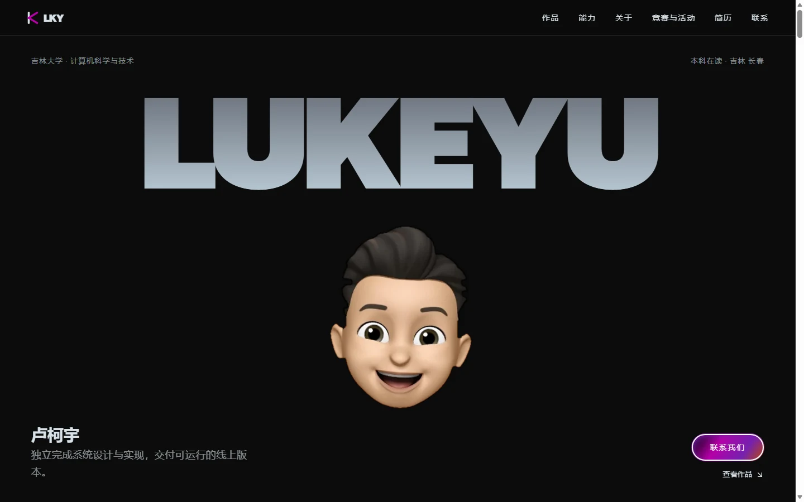
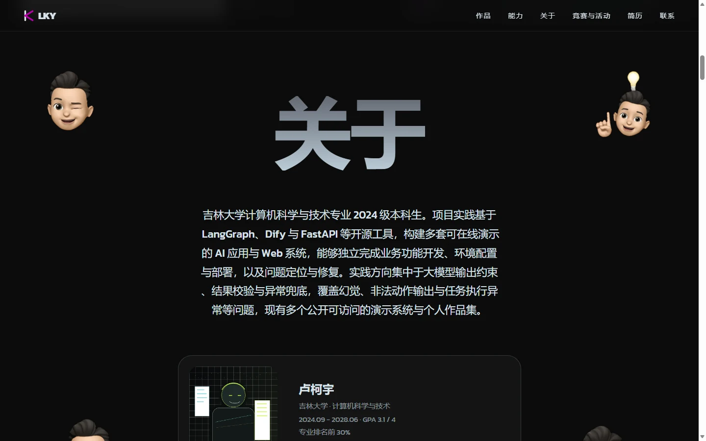
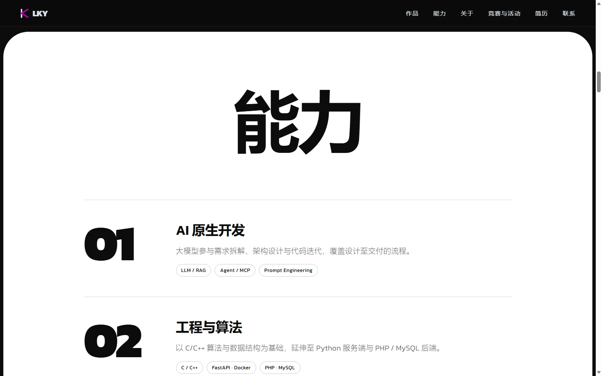
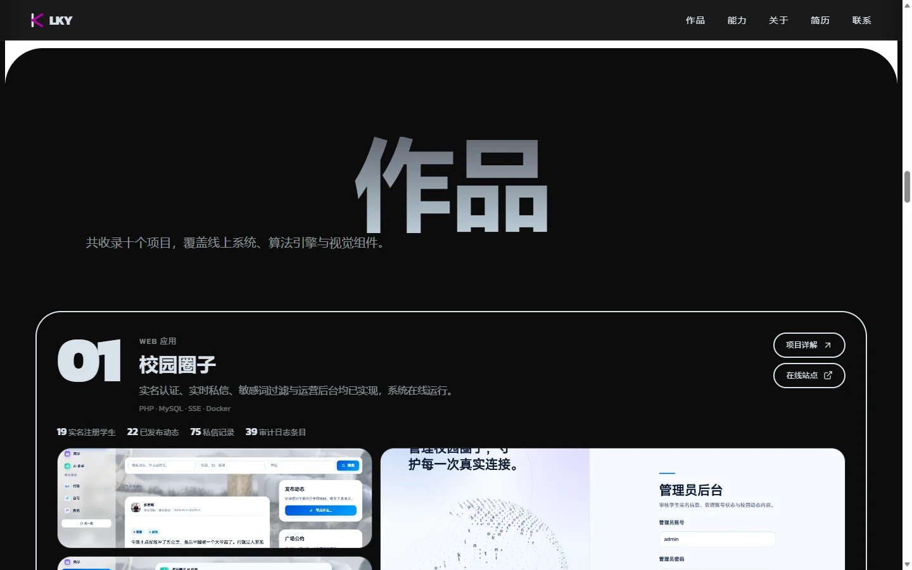
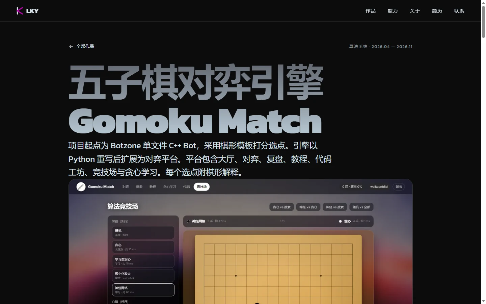
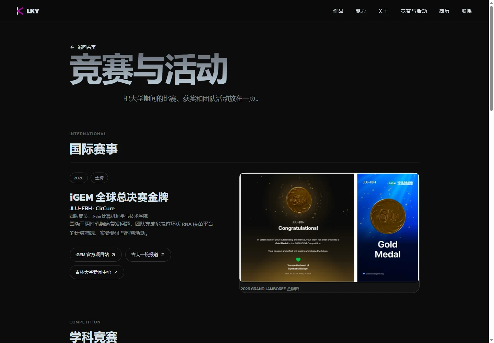
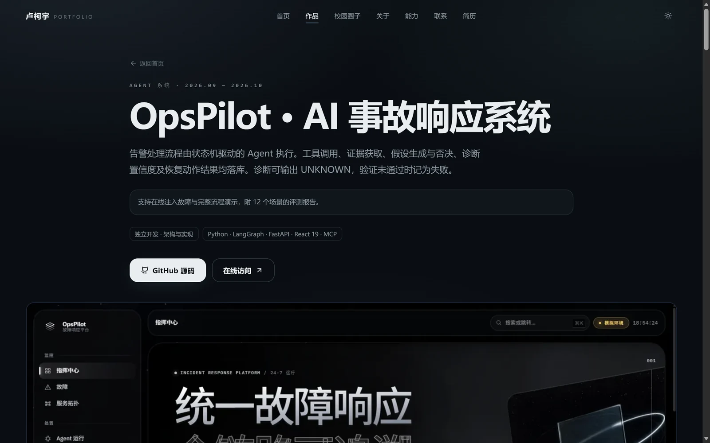
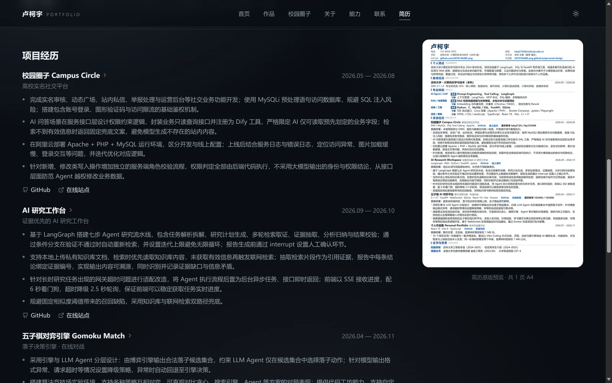
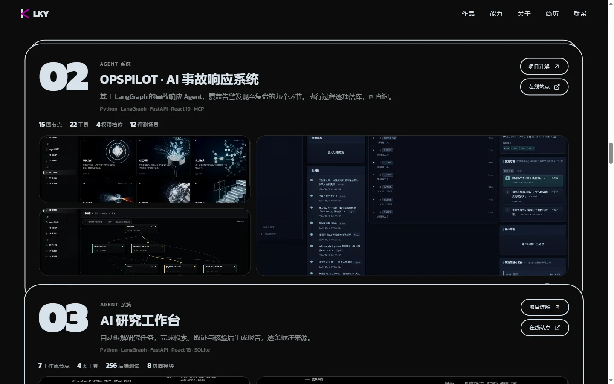
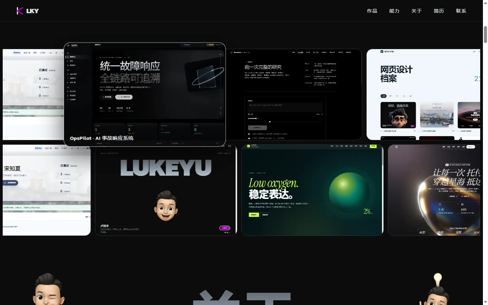

# 个人作品集

卢柯宇的作品集网站。React 19 + Vite 6 单页应用，hash 路由。当前版本为 3D 视觉重构版：纯黑背景、Kanit 渐变大标题、双向反向滚动作品带、白底能力区与 sticky 缩放作品卡。

<p align="center">
  
  
</p>

首屏聚焦作品，教育与荣誉信息置于关于页与简历页。竞赛与活动页汇总证书、iGEM 金牌图与官方链接。十个作品均由 `src/data.js` 派生，校园圈子映射为统一数据结构后与其余项目共同渲染。

<p align="center">
  
  
</p>

## 在线地址

- 主站：https://lukeyu-portfolio.app.workbuddy.host/?sharecode=VQRU7WNFFG
- 镜像：https://2676136489-png.github.io/personal-design/

两个站点源码相同、构建参数不同，需分别发布。WorkBuddy 的 sharecode 在每次重新发布后更新，对外分享时需完整携带。

## 项目背景

个人作品集面向招聘方与合作伙伴，展示项目范围、技术栈与交付质量，同时作为可长期维护的内容系统。

内容层遵循单一数据源：十个作品共用一份数据与一套详情渲染，新增作品仅修改 `src/data.js`。视觉层独立重构，结构保持不变。图片统一转换为 WebP 并登记尺寸，文案由规则脚本检查。

## 目标用户与场景

| 角色 | 核心场景 |
| --- | --- |
| 招聘方 / 面试官 | 快速了解项目范围、技术栈与交付质量，下载简历 |
| 同行与合作伙伴 | 查看项目详情、访问线上系统与源码 |
| 站点维护者 | 新增作品、更新截图与简历，发布至两个域名 |

## 问题定义

| 问题 | 现状 | 目标 |
| --- | --- | --- |
| 新增作品成本高 | 每个作品单独编写页面 | 作品由数据派生，详情共用一套渲染 |
| 双域名部署易出错 | 资源路径写死导致子路径 404 | 路径统一经 `asset()` 拼接，构建时传入 `--base` |
| 视觉与内容易脱节 | 样式改动影响文案结构 | 新版样式限定在 `.v3` 作用域，旧版分支隔离 |
| 图片与文案缺少约束 | 截图不统一、文案口语化 | 图片统一转 WebP 并生成尺寸表，文案经规则脚本检查 |
| 发布后缓存导致旧页面 | 资源清单缓存，JS 未更新 | 导航附加时间戳并禁用 HTTP 缓存 |

## 产品目标与指标

| 目标 | 指标 | 当前结果 |
| --- | --- | --- |
| 内容结构统一 | 收录作品 | 10 个，均由同一数据源派生 |
| 首屏性能可控 | 图片体积 | 由 14.6MB 压缩至 1.9MB |
| 渲染无回归 | SSR 断言 | 142 + 28 + 43 条通过 |
| 交互与布局正确 | 真实浏览器冒烟 | 41 条通过，覆盖八个板块与五条内页路由 |
| 图片可用 | 逐路由图片解码检查 | 258 张全部解码成功 |
| 文案规范 | 规则检查脚本 | 五类问题零命中 |

## 工程回退

站点仅保留一套对外界面，导航与页脚不提供旧版入口。`?skin=legacy` 为不对外暴露的隐藏开关：142 条 SSR 冒烟断言与两套历史布局脚本依赖旧版 DOM，保留该分支用于回归测试与紧急回退。

旧版 JS 与 CSS 仅在隐藏分支中动态加载。`styles.css` 包含 `body`、`h1`、`a` 等全局选择器，静态引入会影响新版样式；旧版 `App` 会将 react-router 与六个旧页面打入首屏包。新版 `site.css` 的选择器全部限定在 `.v3` 作用域内，不影响旧版。SSR 冒烟脚本直接渲染旧版 `AppShell`。

## 功能范围

| 路由 | 内容 | 动效 |
| --- | --- | --- |
| `/` | 首屏、数据条、作品滚动带、关于、能力、堆叠卡、时间线、简历、联系 | 反向自动滚动、悬停单行冻结并放大、逐字显影、磁吸主视觉、sticky 缩放 |
| `/works` | 十个项目的卡片网格，支持按方向筛选 | 进场淡入 |
| `/awards` | iGEM 金牌、数模竞赛、校内荣誉与团队活动 | 进场淡入 |
| `/resume` | 完整网页简历，与 PDF 同源 | 进场淡入 |
| `/category/:slug` | 方向聚合页 | 进场淡入 |
| `/:slug` | 项目详情，章节按 `data.js` 的六种块统一渲染 | 章节时序入场 |
| `/about` `/skills` `/contact` | 首页对应板块锚点 | 滚动定位 |

<p align="center">
  
  
</p>

## 收录作品

| 项目 | 方向 | 时间 | 源码 |
| --- | --- | --- | --- |
| [OpsPilot · AI 事故响应系统](https://opspilot-v2.app.workbuddy.host/?sharecode=RTXXSZUEYF) | Agent 系统 | 2026.09 — 2026.10 | [GitHub](https://github.com/2676136489-png/OpsPilot) |
| [AI 研究工作台](https://ebed98754f5b4e4abafe591d754aff06.app.workbuddy.host/?sharecode=JJ4JF7TBGM) | Agent 系统 | 2026.09 — 2026.10 | [GitHub](https://github.com/2676136489-png/Personal-agent-development-flow) |
| [网页设计档案](https://wbapp-4ytxtkm2qyyzpnnfhiiqfg.app.workbuddy.host/?sharecode=GHCD2BBZPY) | 前端开发 | 2026.11 | [GitHub](https://github.com/2676136489-png/web-design-archive) |
| [Lumora · 区块插件库](https://wbapp-v2ojc8qetmpj74ypnddj2s.app.workbuddy.host/?sharecode=32KDFEZKHH) | Web 组件 | 2026.11 | [GitHub](https://github.com/2676136489-png/Lumora) |
| [校园圈子](https://www.lucky-campus.top) | Web 应用 | 2026.05 — 2026.08 | [GitHub](https://github.com/2676136489-png/campus) |
| [五子棋对弈引擎 Gomoku Match](https://gomoku-match.app.workbuddy.host/?sharecode=MJAKMJUVAA) | 算法系统 | 2026.04 — 2026.11 | [GitHub](https://github.com/2676136489-png/Gomoku-match) |
| iGEM Glass Wiki 插件 | Web 组件 | 2026.07 | [GitHub](https://github.com/2676136489-png/wiki-plugin) |
| [个人作品集](https://lukeyu-portfolio.app.workbuddy.host/?sharecode=VQRU7WNFFG) | 前端开发 | 2026.07 — 2026.11 | [GitHub](https://github.com/2676136489-png/personal-design) |
| [学习目标管理台](https://study-goal-console-59328.app.workbuddy.host/?sharecode=PCKEDGKLDQ) | Web 应用 | 2026.09 | [GitHub](https://github.com/2676136489-png/Check-in-activity) |
| [菜鸟驿站快递管理系统](https://wbapp-2l4ctx9mw2v4jrjpylnkws.app.workbuddy.host/?sharecode=KLVZBRJP3O) | 系统设计 | 2024.09 — 2024.12 | [GitHub](https://github.com/2676136489-png/Cainiao-Station) |

每个项目均有独立详情页，页首为封面与三格界面图集。设计过程完整的项目展开章节，正文引用的截图不在图集中重复展示。

<p align="center">
  
</p>

简历页与 PDF 为同一份材料的两种形态：首页提供预览与荣誉摘要，`/resume` 提供完整项目要点与排版版本。

<p align="center">
  
</p>

## 结构

```
index.html
src/
  main.jsx          入口，默认加载新版；旧版通过隐藏分支动态加载
  v3/
    App.jsx         hash 路由、锚点滚动
    content.js      从 data.js 派生十个作品、导航与滚动带数据
    lib.jsx         FadeIn / Magnet / AnimatedText / 按钮
    sections.jsx    首页八个板块
    Detail.jsx      作品详情、全部作品、方向聚合、完整简历
    Awards.jsx      竞赛与活动页
    site.css        新版样式，作用域限定在 .v3
  app/App.jsx       旧版路由表、主题、全局转场
  app/Nav.jsx       旧版全局导航与移动端抽屉
  app/Footer.jsx    旧版站点地图与页脚
  pages/            旧版六个页面 + 404 + 三个迁移页
  motion/scroll.tsx GSAP 注册、作用域、揭示动效基座
  lightbox.jsx      图片灯箱
  motion.jsx        迁移页使用的逐字揭示与视差
  router.js         hash 跳转与锚点滚动工具
  data.js           全部内容数据
  design-system.css 旧版设计系统（变量、栅格、按钮、卡片）
  styles.css        旧版配色变量与基础样式
  tw.css            Tailwind 变量桥接
public/media/       图片素材（全部 WebP）
media-src/          截图源图（PNG），不进入构建产物
docs/images/        README 配图
scripts/            构建部署、图片处理、验证脚本
```

## 技术选择

以下条目多数记录隐藏分支中旧版代码的实现取舍，该分支保留用于回归测试。重构版使用 Framer Motion 处理进场与滚动驱动，Kanit 字体通过 `@fontsource/kanit` 自托管，运行时不依赖 Google Fonts。

**hash 路由**。站点同时部署于根目录与 `/personal-design/` 子路径，hash 路由不依赖服务端 rewrite，刷新深层页面不会返回 404。

**`--base` 仅在构建时传入**。主站位于根目录、镜像站位于子路径，前缀不同，不能写入 `vite.config.js`。镜像站构建由 `scripts/deploy-pages.mjs` 传入 `--base=/personal-design/`。

**`public/` 下的图片路径需通过 `asset()` 处理**（由 `src/data.js` 导出）。Vite 仅改写 HTML 与 `import` 路径，不处理 JS 字符串字面量，需手动拼接 `import.meta.env.BASE_URL`。绝对路径在主站可用，在子路径部署时会导致资源 404。

**动画统一使用 ScrollTrigger，不使用常驻循环**。随滚动变化的量交由 `scrub`，进场动画使用触发一次的时间线。不使用粒子、呼吸光与自转装饰。

**`pin` 元素的祖先链不得包含 `transform`**。`position: fixed` 的包含块为最近的带 `transform` 的祖先。ScrollTrigger 的 `pin` 通过 `position: fixed` 实现，祖先链上任意 `transform`（包括动画结束后的恒等变换或 `will-change: transform`）都会使 pin 局限在该祖先内，表现为画廊被顶出视口。

该问题出现过两次：路由转场容器设置了 `will-change: transform, opacity`；旧样式表 `main { animation: page-in ... both }` 在动画结束后保留恒等 `transform`。解决方案为转场动画结束时显式 `clearProps: 'transform'`，并为该规则增加断言。

**吸附位置自行计算，未使用 ScrollTrigger 内置 `snap`**。内置 `snap: { snapTo }` 在单次大幅滚动时传入的 `progress` 与实际几何不一致，实测滚动至 1400px 时按 0.37 计算，落点偏差一屏。渐进滚动表现正常，手动测试难以发现。

实现改为从 `onUpdate(self)` 读取 `self.progress`，停止 180ms 后按 `st.start + target * (st.end - st.start)` 滚动。拖拽期间不吸附，松手时根据当前 `scrollY` 反算后吸附。

**拖拽期间逐帧 `scrollTo` 必须使用 `behavior: 'instant'`**。站点全局启用 `scroll-behavior: smooth`，未指定 `instant` 时每帧均被平滑处理，拖拽响应明显滞后。

**移动端采用独立版式，而非缩小桌面版**。`<768px` 时关闭画廊 `pin` 与拖拽，降级为纵向 Bento 网格，仅保留淡入；叙事页关闭遮罩，封面改为一次淡入；首屏不再占满一屏高度。上述分支由 `matchMedia` 控制。

**遮罩的初始 `clip-path` 仅写入桌面断点**。`clip-path: inset(0 0 100% 0)` 表示完全收起，桌面版由 GSAP 随滚动揭开。移动端不执行该动画，初始值若保留会导致封面被裁切。

**两列的列定义必须写入 CSS，不能使用 inline style**。inline 样式优先级高于媒体查询，`style={{ gridTemplateColumns: '1fr 1fr' }}` 会使 `<860px` 的折叠规则失效。统一使用 `.ds-split`，页面仅传入 `--split` 比例变量。

**排版重置使用 `:where()` 将特异性降为 0**。`.ds-page p { margin: 0 }` 的特异性为 0,1,1，会覆盖 `.ds-eyebrow { margin-bottom: 24px }`（0,1,0）。

**移动端卡片标题置于图片下方**。压图方案使用渐变加白字，封面明暗不定时对比度不足（实测 1.4:1）。改为常规流的图片与文字块，适配任意封面。

**三个迁移页面仅替换视觉层，不重写结构**。作品详情、方向聚合、简历页为长文档，结构保持原样，视觉统一下沉至 `.legacy-doc` 覆盖层，采用新版圆角、按钮与眉标。

**`` 的 `width` / `height` 为固定像素提示**，优先级低于 CSS、高于 `auto`。仅设置 `width: 100%` 而未设置高度时，图片会被属性中的固定高度拉伸。全局 `img` 规则显式设置 `height: auto`。

主题偏好存储于 `localStorage`，key 带版本号（`portfolio-theme-v2`）。整体视觉更换后，旧 key 中的偏好对应上一套外观，继续使用会导致访客无法看到新样式。

### 重构版取舍

**作品卡的三格素材互不重复**。有线上界面的项目从站点抓取不同视图，无线上界面的项目使用仓库中的真实截图。此前使用同一封面补齐三格，九张卡中有六张重复。断言逐卡检查图源唯一性。

<p align="center">
  
</p>

**首屏主视觉为 Memoji 头像**。原始素材位于 `图片/`，`media-src/make-memoji-set.py` 通过洪水填充去除白底并内收边缘，输出首屏 720×720 与四角 480×480 的透明 WebP。首屏使用微笑正面，关于页四角分别为眨眼、灯泡、点赞、MacBook 四张表情。

**渐变标题的动画 transform 置于外层 wrapper**。`background-clip: text` 与元素自身 transform 在部分浏览器中存在冲突，直接作用于 `h2` 会导致文字不可见。

**逐字显影区间限定在 progress 0—0.9**。覆盖 0—1 时末尾文字无法完全点亮；保留尾部余量可确保读者滚动至段落时文字已完成显影。

**新版 `` 同样需要 `height: auto`**。设置 `width` / `height` 属性可防止 CLS，但未设置 `height: auto` 时固定像素会导致图片纵向拉伸。

**按钮文字色需覆盖 `.v3 a { color: inherit }`**。该重置的特异性为 0,1,1，高于 `.v3-btn-ink` 的 0,1,0。按钮规则写为 `.v3 a.v3-btn-ink` 并显式指定 `-webkit-text-fill-color`。

**滚动带循环周期按「一组图 + 组间距」实测**。周期由 tile 实测宽度与 CSS `columnGap` 计算；使用 `scrollWidth / 3` 近似会少一个间隔，接缝处产生 12px 抖动。

**两行暂停状态各自独立**。指针进入某一行时该行速度缓降至 0，另一行保持运行；停止后页面滚动视差不再写入该行 transform。页面滚动视差仅在 scroll 事件中计算并缓存，rAF 中不调用 `getBoundingClientRect`。

<p align="center">
  
</p>

## 本地开发与发布

```bash
npm install
npm run dev
```

## 构建与发布

```bash
npm run build          # 产物在 dist/
```

主站以静态服务托管 `dist/`，监听 `$PORT`：

```bash
cd dist && python3 -m http.server ${PORT:-3000} --bind 0.0.0.0
```

镜像站：

```bash
node scripts/deploy-pages.mjs
```

脚本重新构建至 `dist-pages/`（带 `--base=/personal-design/`），推送至 `gh-pages` 分支。主分支仅存放源码，构建产物独立发布，避免截图增大仓库体积。

Pages 首次启用需在仓库 Settings → Pages 中将 Source 设为 `Deploy from a branch`，分支选择 `gh-pages`，目录选择 `/(root)`。

**推送前需确认解析地址可用**。`http.curloptResolve` 将 `github.com` 固定至指定 IP，绕过本地 DNS。固定 IP 失效时直连超时、代理返回 502。`scripts/github-push.js` 维护候选地址池，通过 `git ls-remote` 逐个探测，推送失败时自动切换地址或代理重试。

```bash
node scripts/push-main.mjs      # 执行测试后推送 main，失败自动换址重试
```

地址探测使用 git 而非 curl：curl 使用 OpenSSL，git 使用 schannel（Windows TLS），两者对边缘节点的兼容性不同，实测存在 curl 返回 200 而 git 无法连接的情况。同一地址可能间歇性不稳定，探测需连续两次失败后判定不可用；代理端口处于 LISTENING 状态不代表上游可用，探测前需清除代理环境变量。`api.github.com` 与 `raw.githubusercontent.com` 使用独立解析链路，与 git 通道分别判断。

## 图片处理

截图源图位于 `media-src/`（PNG），由 `scripts/optimize-images.py` 统一转换为 WebP 并写入 `public/media/`，构建产物不含 PNG。整站图片体积由 14.6MB 降至 1.9MB。

README 配图分两条链路：旧版由 `scripts/shoot-docs.mjs` 抓取界面、`scripts/make-docs-images.py` 压缩为 WebP；重构版由 `scripts/verify-v3.mjs` 在本地预览站抓取 `screenshots/v3-*.png`，再由 `scripts/make-v3-docs-images.py` 压缩至 1600 宽（`docs/images/v3-*.webp`，7 张合计 371KB）。界面变更后需重新执行。旧版抓图默认取线上主站，本地回归可传 `SITE_BASE` 与 `SITE_QS` 指向构建产物。

作品卡截图使用独立链路：源图为各项目仓库 `docs/` 下的界面截图，以及 `scripts/capture-portfolio-views.mjs` 从线上站点抓取的三个画面，统一存放于 `media-src/captured/`。`scripts/make-gallery-images.py` 压缩至 1400 宽并写入 `public/media/gallery/`（30 张合计 1489KB），同时生成 `src/v3/gallery-sizes.json` 供 `` 设置宽高。

## 简历

简历页与 PDF 为同一份材料的两种形态，修改时需同步更新。

PDF 为最终版本。母版位于 `简历制作/01_母版/`，发布时复制到 `public/media/resume/lukeyu-resume.pdf`。页面预览图由 `scripts/make-resume-preview.py` 从 PDF 直接渲染（`resume.webp` 1588 宽、`resume-900.webp` 900 宽），确保预览与下载内容一致。

网页内容全部来自 `src/data.js` 的 `resume` 字段：个人优势与项目技术描述位于 `advantages` / `projectHighlights`；项目标注行位于 `projectMeta`，记录项目定位；技能分组与证书位于 `skillGroups` / `honors`。上述内容与 PDF 逐条一致，不使用详情页的 `lede`。

项目列表由 `resume.projectSlugs` 决定，不在页面中硬编码，断言同样从该字段派生。

**简历字段需单独设置存在性断言**。内容断言多采用 `data.resume.advantages || []` 的兜底写法，字段缺失时仅报告内容为空而非字段缺失；页面中为 `resume.advantages.map(...)`，字段缺失将导致渲染异常与白屏。`smoke-render.mjs` 在渲染前执行字段契约断言，先确认字段存在再渲染。

**README 引用的配图需断言存在**。此类问题在本地与线上均不易发现，页面与测试均正常，仅图片无法显示。

**网页与 PDF 的一致性需直接读取 PDF 比对**。仅检查数据源内部自洽无法发现两边表述不一致。断言读取 `public/media/resume/lukeyu-resume.pdf`，提取文字后与 `resume.advantages` / `resume.projectHighlights` 逐条比对，比对前去除空白字符。

## 范围边界

- 旧版界面仅通过 `?skin=legacy` 访问，不对外露出。
- 内容数据集中于 `src/data.js`，页面不硬编码作品信息。
- 图片资源全部本地化，不依赖外部图床或 CDN。
- 双域名部署需分别发布，构建参数不同。

## 质量验证

三个 SSR 冒烟脚本：在 Node 侧通过 `react-dom/server` 渲染组件后断言，不依赖浏览器。

```bash
node scripts/smoke-render.mjs      # 路由、内容、数据契约、设计系统约束（137 条）
node scripts/smoke-nav.mjs         # 导航结构、激活态、抽屉与主题契约（28 条）
node scripts/smoke-lightbox.mjs    # 图片灯箱结构与交互契约（43 条）
node scripts/verify-v3.mjs         # 重构版真实浏览器冒烟（40 条 + 截图）
node scripts/audit-images.mjs      # 逐路由滚动，检查图片解码
```

前三套为 SSR 冒烟测试，渲染 legacy 皮肤，共 137 + 28 + 43 条断言。`verify-v3.mjs` 通过 CDP 在真实浏览器中检查八个板块、十个作品卡与两条反向滚动带。断言覆盖三格图源唯一性、截图 404、按钮对比度与悬停冻结恢复。sticky 缩放、逐字显影与四条内页路由同样纳入。详情页封面与图集、390px 移动端、旧版入口隐藏及控制台报错均在检查范围内。脚本另产出 README 配图源文件。

`audit-images.mjs` 覆盖图片路径错误、构建漏拷与 CDN 缺失等 SSR 无法发现的问题。脚本将 14 条路由逐条滚动到底，等待每个 `` 的 `decode()` 完成，并扫描 CSS 背景图。当前 251 张图片全部解码成功。判定加载状态使用 `decode()` 而非 `complete`，后者在流式加载中返回 `false`，会产生误报。

断言分为两类：内容渲染结果与实现契约。后者防止重构时引入已修复的问题，例如转场结束未清除 transform 导致画廊 pin 错位。

**SSR 脚本共用一份 DOM 桩**（`scripts/lib/ssr-dom.mjs`）。GSAP ScrollTrigger 在模块加载时即调用 `document.body` 的多种方法，独立实现易出现遗漏。

该桩包含一处 Windows 专有问题：Vite 经 `realpath` 将盘符规范为大写（`D:\`），脚本自身 `import 'react'` 使用小写（`d:\`），同一文件被 Node 视为两个模块，出现两份 React，报错为 `Invalid hook call` 或 `Cannot read properties of null (reading 'useRef')`。解决方案为服务端启用 `resolve.preserveSymlinks`。

文案检查脚本将「避免 AI 化表达」转化为可执行规则：

```bash
node scripts/check-copy.mjs
```

检查五类问题：禁用词、破折号作停顿、句子过长、三段排比、标签式套话。范围覆盖数据文件与页面组件，包括 JSX 中的文案。

长度限制区分两套标准：界面文案按整句 32 字，简历正文按分句 32 字。字数按阅读长度计算，中文一字计 1，英文单词计 1，`PHP / MySQL` 计 2。

每条规则配置固定正反例，规则被修改时脚本先报告「判据自测失败」再退出。

反例验证：

```bash
node scripts/mutation-check.mjs
```

脚本将每项修复临时还原为错误写法，确认对应断言失败且退出码非 0 后还原。二十条反例覆盖设计系统约束、路由、pin 配置、简历口径与文案规则。

布局与交互需由真实布局引擎验证。本机安装 Edge，通过 CDP 驱动：

```bash
node scripts/verify-layout.mjs            # legacy 皮肤：九条路由 + pin / 吸附 / 转场 / 移动端降级
node scripts/verify-projects.mjs          # legacy 皮肤：作品列表与详情页
node scripts/push-main.mjs                # 执行测试后推送 main
```

两套 CDP 脚本验证重构前的布局，URL 均带 `?skin=legacy`。`shoot-docs.mjs` 抓取的也是 legacy 配图。

`verify-layout.mjs` 中两项关键指标为「pin 期间 bandTop 是否接近 0」与「祖先链是否存在 transform」，前者验证横滚生效，后者用于定位失效原因。

导航请求自动附加时间戳参数并禁用 HTTP 缓存。参数需插入 `#` 之前，`#` 之后的内容不会发送至服务器。资源清单位于 `index.html`，浏览器缓存旧清单时会继续使用旧的 `assets/index-<hash>.js`，表现为代码已更新但页面未变化。
